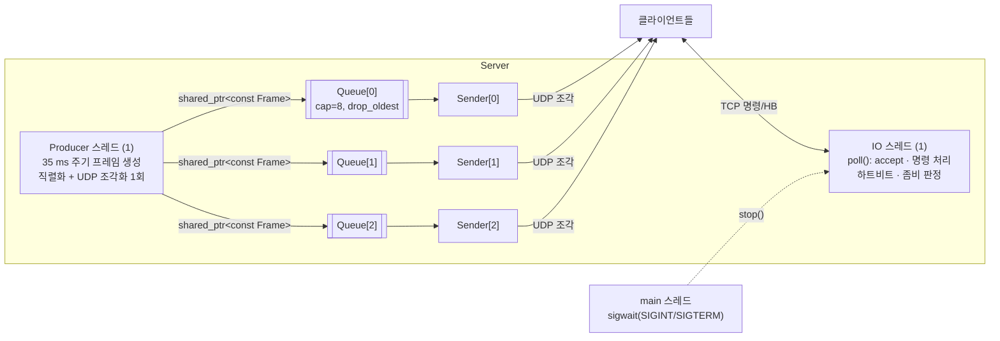
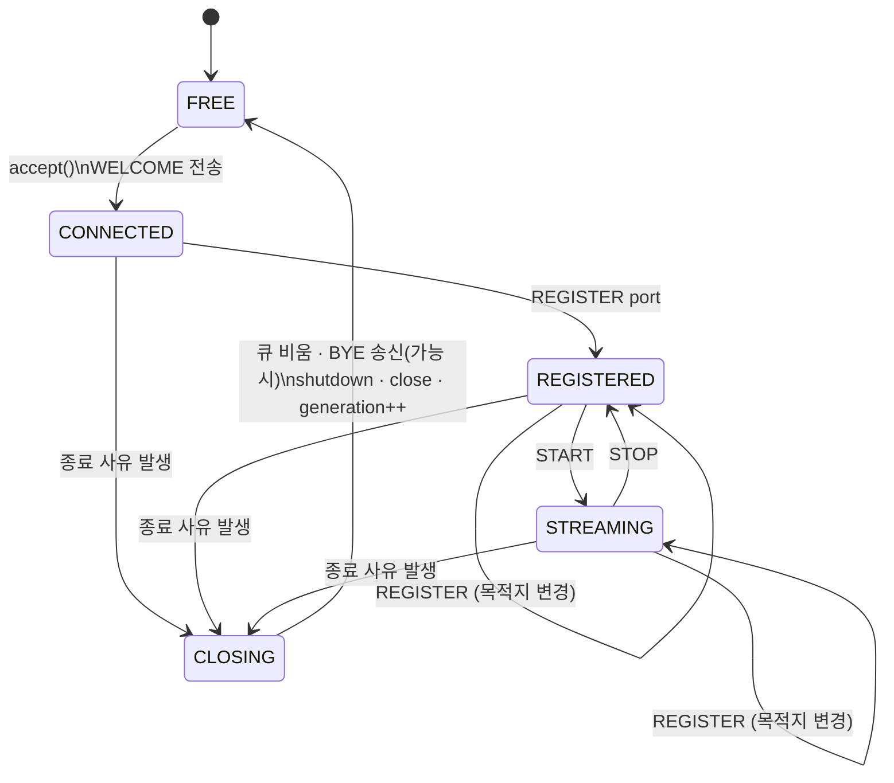

# 설계 문서 — RadarSim 다중접속 트랙 서버

## 1. 개요

TCP 명령 포트(기본 8088)로 최대 N개(기본 3) 클라이언트가 접속하고, 각 클라이언트는
`REGISTER <udp_port>`로 등록한 UDP 포트로 35 ms마다 생성되는 가짜 트랙 프레임을 받는다.
서버는 하트비트로 클라이언트 생존을 확인하고, 죽은 연결(좀비)을 정리해 슬롯을 회수하며,
SIGINT/SIGTERM 시 모든 클라이언트에 `BYE SHUTDOWN`을 보내고 정상 종료한다.

## 2. 소켓 API 선택: POSIX 소켓 + `poll()`

| 후보 | 판단 |
|---|---|
| **POSIX 소켓 + poll()** | **채택.** 외부 의존성 0, 동작이 전부 코드에 드러난다. 과제 목적(동시성·장애 처리 연습)상 EOF/ECONNRESET/EAGAIN/EPIPE를 직접 다뤄야 좀비·kill -9 동작을 정확히 이해할 수 있다. 접속 상한이 3이라 `poll()`의 O(n) 비용은 무의미하다. |
| Boost.Asio | 이식성(Windows)과 strand/타이머가 강점이지만, Boost 설치가 필요하고 completion handler 수명·strand 규칙이 오히려 학습 대상을 가린다. |
| libuv | 이벤트 루프는 좋으나 C API라 RAII와 맞추려면 래퍼가 필요하고, 루프 스레드 밖에서 핸들을 만질 수 없어 Producer–Consumer 구조와 결합 시 `uv_async` 우회가 필요하다. |

트레이드오프: Linux(WSL 포함) 전용이다(`accept4`, `pipe2`, `MSG_NOSIGNAL`). 이식이 필요하면 IO 스레드만 Asio로 교체하면 되도록 소켓 코드를 `Server`의 IO 스레드 함수에 모았다.

## 3. 스레드 구조와 큐



| 스레드 | 개수 | 역할 | 소유/접근 자원 |
|---|---|---|---|
| main | 1 | `sigwait()`로 SIGINT/SIGTERM 동기 수신 → `Server::stop()` | — |
| IO | 1 | `poll()` 루프: accept, 줄 단위 명령 파싱·응답, 하트비트 송신, 좀비 판정, 슬롯 해제 | **모든 TCP 소켓의 유일한 소유자** |
| Producer | 1 | `frame_interval`(35 ms)마다 프레임 1개 생성 → STREAMING 슬롯 큐 전부에 push | 트랙 생성기 |
| Sender | 슬롯 수(3) | 자기 슬롯 큐에서 pop → UDP `sendto` | 슬롯별 UDP 소켓 |

### 설계 결정

- **TCP 소켓은 IO 스레드만 만진다.** 하트비트·응답·종료 모두 같은 스레드에서 일어나므로 fd 수명에 락이 필요 없고,
  "다른 스레드가 닫힌 fd(혹은 재사용된 fd 번호)에 쓰는" 고전적 버그가 구조적으로 불가능하다.
  하트비트와 좀비 판정 타이밍은 `poll()` timeout을 "다음 마감 시각"으로 계산해 처리한다(별도 타이머 스레드 없음).
- **클라이언트별 큐 + 클라이언트별 Sender.** 느린 클라이언트 하나가 다른 클라이언트나 Producer를 막지 못한다(격리).
  큐를 하나만 두고 Sender가 모두에게 보내면, 한 클라이언트의 송신 지연이 전체를 지연시킨다.
- **Zero-copy fan-out.** 프레임은 Producer에서 한 번만 직렬화·조각화되고 `shared_ptr<const PreparedFrame>`로 모든 큐에 공유된다. 불변 객체이므로 읽기에 락이 필요 없다.
- **Producer는 절대 블로킹하지 않는다.** 레이더 주기(35 ms)는 실시간 제약이므로 소비자가 느리다고 생산을 멈추면 안 된다.

### 큐 정책 (크기 제한 · 가득 찼을 때 · 버린 개수)

- `BoundedQueue<T>`: mutex + condition_variable, 용량 `queue_capacity`(기본 8 프레임 ≈ 280 ms 분량).
- **가득 찼을 때: `drop_oldest`(기본)** — 가장 오래된 프레임을 버리고 새 프레임을 넣는다.
  트랙 데이터는 최신 값이 가치가 있으므로(오래된 위치는 곧 쓸모없음), 지연된 옛 데이터를 보내는 것보다 버리는 편이 낫다.
  설정으로 `drop_newest`(새 것을 거부)도 선택 가능.
- **버린 개수 집계**: 큐 자체(`dropped()`), 슬롯별(`STATUS`의 `dropped=`), 서버 전체(`ServerStats::frames_dropped`)에 기록되고 슬롯 해제 로그에도 남는다.
- 슬롯 해제 시 남은 프레임은 `clear()`로 폐기하며 이는 drop으로 세지 않는다(`discarded_in_queue`로 로그).

### 동기화 규칙과 경쟁 조건 처리

- 슬롯의 공유 상태(`state`, `peer`, `udp_dest`, `generation`)는 슬롯 mutex로 보호.
- **Sender는 슬롯 mutex를 잡은 채로 한 프레임을 보낸다.** IO 스레드가 STOP/해제로 상태를 바꿀 때도 같은 mutex를 잡으므로,
  `OK STOPPED` 응답 이후나 슬롯 해제 이후에는 그 클라이언트로 데이터그램이 나가지 않는다(UDP 소켓은 non-blocking이라 락 보유 시간이 짧다).
- **generation 카운터**: 슬롯이 해제될 때마다 증가. 큐 항목은 push 시점의 generation을 담고, Sender는 불일치 항목을 버린다.
  큐 정리와 재접속 사이 경쟁으로 이전 클라이언트의 프레임이 새 클라이언트에게 가는 일을 막는다.
- 락 순서: 슬롯 mutex → 큐 mutex (Producer). Sender는 pop(큐 락만) 후 슬롯 락을 잡으므로 중첩 순서가 뒤집히지 않아 교착이 없다.
- 시그널: 모든 스레드에서 SIGINT/SIGTERM을 block하고 main이 `sigwait()`으로 받는다. 비동기 시그널 핸들러 안에서 하는 일이 없다.
  `SIGPIPE`는 무시 + `MSG_NOSIGNAL`.
- ThreadSanitizer 빌드(`-DRADAR_SANITIZER=thread`)로 전체 테스트 실행 시 data race 보고 0건.

## 4. 슬롯 수명주기 상태도



`FREE`가 아닐 때 다 찬 경우: 새 접속은 슬롯에 들어가지 않고 `ERR FULL` 전송 후 즉시 닫힌다(상태 변화 없음).

| 종료 사유 (`CloseReason`) | 트리거 | 클라이언트에 보내는 줄 |
|---|---|---|
| `quit` | `QUIT` 명령 | `BYE` |
| `peer-closed` | `recv() == 0` (FIN) — 정상 종료 **및 kill -9** | — |
| `reset` | `recv/send` 오류(ECONNRESET, EPIPE …) | — |
| `zombie-timeout` | `zombie_timeout` 동안 수신 바이트 0 | `BYE TIMEOUT` (시도) |
| `zombie-stalled` | 클라이언트가 읽지 않아 출력 버퍼 64 KB 초과 | — |
| `protocol-error` | 한 줄이 `max_line_bytes` 초과 | `ERR LINE_TOO_LONG` |
| `shutdown` | 서버 종료 | `BYE SHUTDOWN` |

CLOSING 처리 순서: 상태를 CLOSING으로(슬롯 락 — 진행 중인 UDP 송신 완료 대기) → 큐 비움 → 마지막 줄 송신 →
`shutdown(SHUT_WR)` + 남은 입력 drain(RST 대신 FIN을 보내 BYE가 유실되지 않게) → `close()` → FREE + generation++.

## 5. 좀비 판정 기준과 근거

### 죽음의 종류와 감지 방법

| 상황 | 커널이 알려주나? | 감지 방법 | 소요 시간 |
|---|---|---|---|
| 정상 종료 / `QUIT` | 예 (FIN) | `recv()==0` 또는 QUIT | 즉시 |
| **프로세스 강제 종료 (kill -9)** | **예** — 커널이 프로세스의 소켓을 닫으며 FIN 전송 | `recv()==0` → `peer-closed` | **즉시** (테스트에서 0~수 ms) |
| 프로세스 정지(SIGSTOP)·무한루프·데드락 | 아니오 — 커널은 연결을 살아 있다고 봄 | **애플리케이션 하트비트 타임아웃** | ≤ `zombie_timeout` |
| 호스트 다운·케이블 단절·NAT 만료 | 아니오 — FIN/RST가 오지 않음 | 하트비트 타임아웃 (또는 송신 실패) | ≤ `zombie_timeout` |
| 수신은 안 하고 연결만 유지 | 아니오 | 출력 버퍼 64 KB 초과 → `zombie-stalled` | 버퍼가 찰 때 |

kill -9는 흔히 "좀비"로 생각되지만, 실제로는 커널이 FIN을 보내 주므로 **EOF로 즉시** 회수된다.
진짜 좀비는 "연결은 살아 있는데 상대가 응답하지 않는" 경우이고, 이는 TCP 계층이 알려주지 않으므로 애플리케이션 하트비트가 필요하다.

### 규칙

> **마지막으로 클라이언트로부터 바이트를 받은 시각(`last_rx`)으로부터 `zombie_timeout` 이상 지나면 좀비로 판정하고 슬롯을 회수한다.**

- 서버는 `heartbeat_interval`(기본 1000 ms)마다 `HB <seq>`를 보내고, 클라이언트는 `PONG <seq>`로 답한다.
- PONG에 한정하지 않고 **어떤 명령이든 수신하면 생존**으로 본다(`last_rx` 갱신). 바쁜 클라이언트에게 추가 부담을 주지 않는다.
- 기본값 `zombie_timeout = 3500 ms = 3 × heartbeat + 500 ms`.

### 수치의 근거

- **3회 연속 무응답**: 하트비트 1회 손실/지연(스케줄링 지연, GC 멈춤, TCP 재전송 — Linux 최소 RTO 200 ms)으로 정상 클라이언트를 끊지 않기 위함. 2회는 오탐 여지가 있고 5회 이상은 슬롯(최대 3개뿐) 회수가 너무 늦어진다.
- **+500 ms 여유**: 3번째 HB에 대한 PONG이 RTT + 클라이언트 처리 시간만큼 늦게 도착하는 것을 허용.
- **감지 지연 상한**: 마지막 응답 후 정확히 `zombie_timeout`(poll timeout을 마감 시각으로 계산하므로 주기적 스캔 오차 없음). 테스트에서 400 ms 설정 시 399 ms에 회수 확인.
- **TCP keepalive를 쓰지 않은 이유**: 기본 시작 시간이 2시간이고, 소켓별로 줄여도 "프로세스는 멈췄지만 커널은 살아 있는" 경우(SIGSTOP, 데드락)를 못 잡는다 — 커널이 ACK를 대신 보내기 때문.
- `zombie_timeout > heartbeat_interval`은 설정 검증에서 강제한다.

## 6. 프로토콜

### TCP 명령 (줄 단위 텍스트, `\n` 종료, 키워드 대소문자 무시, `\r\n` 허용)

| 클라이언트 → 서버 | 서버 응답 | 설명 |
|---|---|---|
| (접속) | `WELCOME RADARSIM/1.0 slot=<i> max=<n> hb_ms=<ms> timeout_ms=<ms>` | 환영 메시지 |
| (접속, 만석) | `ERR FULL` 후 연결 종료 | |
| `REGISTER <udp_port>` | `OK REGISTERED udp=<ip>:<port>` | 목적지 IP는 **TCP 접속 주소로 고정** — 제3자에게 UDP를 쏘게 하는 반사 공격 방지 |
| `START` | `OK STREAMING` / `ERR NOT_REGISTERED` | |
| `STOP` | `OK STOPPED` / `ERR NOT_REGISTERED` | |
| `PING [token]` | `PONG [token]` | 클라이언트 측 RTT 확인용 |
| `PONG [seq]` | (없음) | 서버 `HB <seq>`에 대한 응답 |
| `STATUS` | `OK STATUS slot= state= udp_port= frames_sent= fragments_sent= dropped= queue=a/b` | |
| `QUIT` | `BYE` 후 종료 | |
| 그 외 | `ERR UNKNOWN_COMMAND <kw>` / `ERR BAD_ARGUMENT <msg>` | 연결 유지 |
| 256 바이트 초과 줄 | `ERR LINE_TOO_LONG` 후 종료 | 메모리 고갈 방지 |
| (서버 → 클라이언트) | `HB <seq>` | 하트비트 |

### UDP 프레임

트랙 1개 24 바이트(id u32, range/azimuth/elevation/velocity/rcs f32), 프레임 = 헤더 16 바이트(seq u32, timestamp_us u64, count u32) + 트랙들. 리틀 엔디언.
프레임은 `max_datagram_bytes`(기본 512) 이하 조각으로 나뉘며 각 조각에 20 바이트 헤더가 붙는다:

```
magic u32 "RDR1" | frame_seq u32 | frag_index u16 | frag_count u16 | total_size u32 | offset u32 | payload…
```

기본 64 트랙 = 1552 바이트 → 조각 4개/프레임. 수신 측 `FrameReassembler`가 순서 무관 재조립, 중복 무시, 오래된 미완성 프레임 폐기를 담당한다.
기본값 512는 조각화 동작을 보여주기 위한 값이며, 실제 망에서는 IP 단편화를 피하는 ~1400이 적절하다.

## 7. 테스트 전략

| 요구 테스트 | 테스트 | 방법 |
|---|---|---|
| 좀비 판정 | `Liveness.*` (unit) | 가상 시계로 판정 함수 경계값, 응답하는 클라이언트 60 s 무오탐, 침묵 클라이언트 정확한 감지 시각 |
| | `ServerIT.FrozenClientIsReapedByHeartbeatTimeout` | 실제 `radar_client` 프로세스를 **SIGSTOP** → FIN 없이 멈춤 → 타임아웃으로 회수 (400 ms 설정 → ~400 ms) |
| | `ServerIT.SilentClientIsZombieResponsiveClientIsNot` | 무응답 클라이언트만 회수, 응답 클라이언트 유지 |
| 4개 동시 접속 → 4번째 거부 | `ServerIT.FourthConcurrentClientGetsErrFullAndIsClosed`, `FourSimultaneousConnectsExactlyOneRejected` | 순차/동시(스레드 4개) 접속, `ERR FULL` + EOF, 기존 3개 영향 없음, 슬롯 재사용 |
| 3개 동시 스트리밍 → 수신 조각 수 | `ServerIT.ThreeClientsStreamConcurrently` | 3개가 병렬 1.5 s 수신 → 클라이언트별 수신 조각 수를 서버 `STATUS`의 `fragments_sent`와 비교 (예: 168/168/168) |
| kill -9 → 슬롯 회수 | `ServerIT.KillDash9ClientReleasesSlotImmediately` | 실제 자식 프로세스 SIGKILL, zombie_timeout 30 s로 두어 **타이머가 아닌 EOF로** 회수됨을 증명 (~0 ms) |
| | `ServerIT.KillDash9WhileFullLetsANewClientIn` | 만석 → kill -9 → 새 클라이언트 입장·수신 |
| 정상 종료 | `QuitClosesGracefully`, `ServerShutdownSaysByeToEveryone` | `BYE` / `BYE SHUTDOWN` + EOF |
| 큐 | `BoundedQueue.*` (unit) | drop_oldest/newest 동작과 집계, close 시 소비자 깨우기, 4 생산자 경쟁에서 `소비 + 드롭 == 생산` |

모든 통합 테스트는 포트 0(임시 포트)을 써서 병렬 실행이 가능하고, 타이밍 의존 테스트는 짧은 하트비트(100~200 ms)로 빠르게 끝난다(전체 약 2 s).

## 8. 한계와 개선 여지

- Linux 전용(POSIX). Windows 지원은 IO 스레드를 Asio로 바꾸거나 Winsock 분기 필요.
- 접속 수가 커지면 `poll()` → `epoll`로, 슬롯당 Sender 스레드 → 고정 크기 Sender 풀로 바꾸는 것이 맞다.
- 인증/암호화 없음. UDP 목적지는 TCP 접속 IP로 고정해 반사 공격만 막았다.
- 테스트 환경 참고: GCC 11 TSan은 최신 WSL 커널에서 `setarch -R`이 필요하고, `pthread_cond_clockwait` 미지원으로 생기는 오탐 1종을 `tests/tsan.supp`에서 억제한다(data race 억제 아님).
